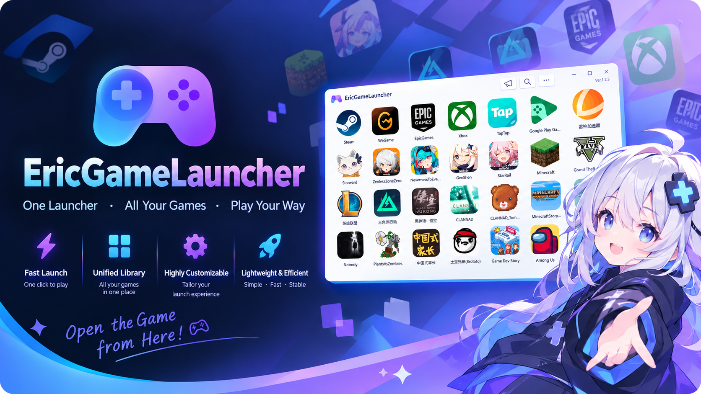
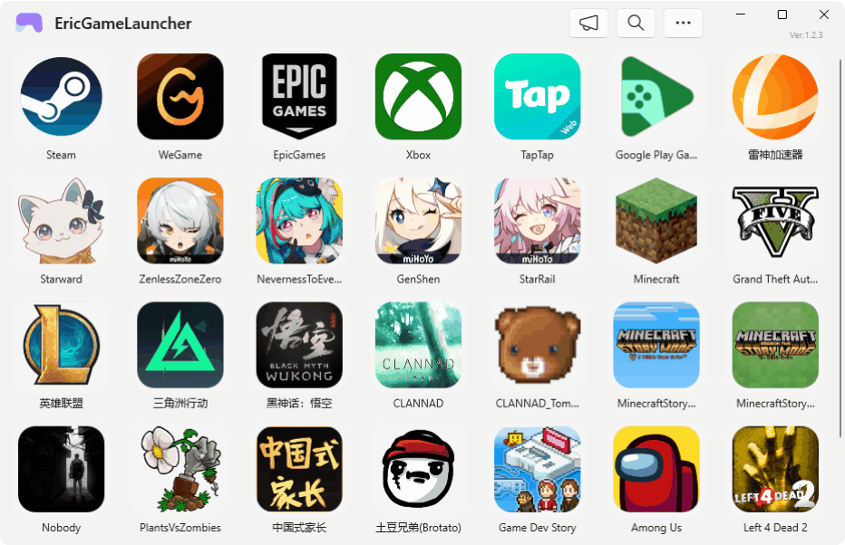
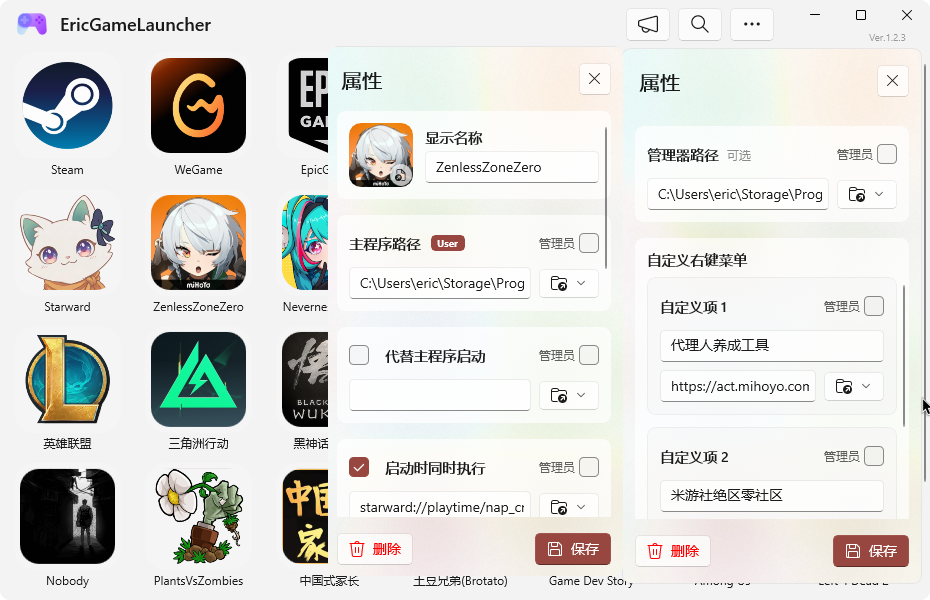
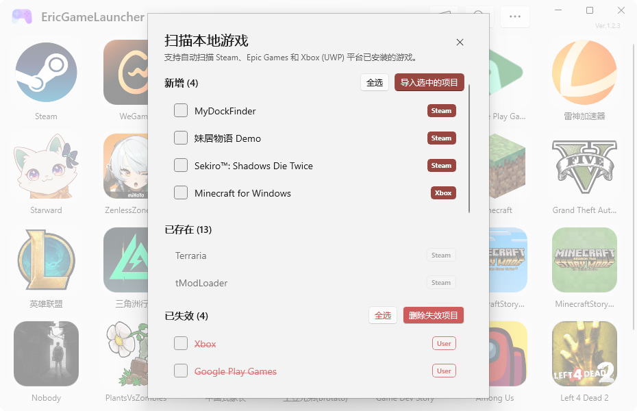
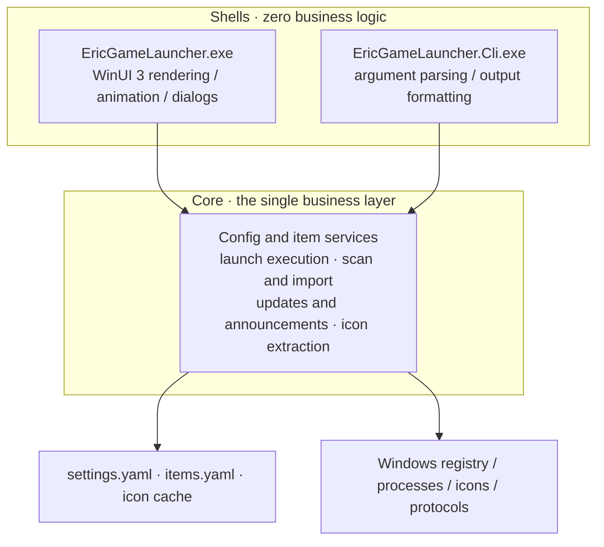

<!--
 readme编写规范：
  1. 所有readme都需要保留本说明且不可做任何翻译修改。主readme(中文版)是本说明的唯一源头(Source of Truth)，禁止将非中文版本中被修改的说明同步回主readme。非中文版的此说明需始终保持与主readme单向同步更新。
  2. 非中文版本的readme必须保留主readme(中文版)的所有视觉元素、HTML 标签、图标路径和排版格式，非中文版本的readme是中文版的完整对应精准同步翻译版，翻译不可笼统，不可修改原意，不可增减内容。
  3. 针对目标语言环境进行功能描述的本土化。
  4. 非中文版本的readme需要合理修改指向资源的路径，确保资源能够正确显示。
  5. 非中文版本的readme都需要保留并置顶本说明
  6. 非中文版本的readme都需要置顶以下元素，可以替换为相应的翻译版本但必须保留原意：
	    <div align="right">
	    <a href="../readme.md">For the latest updates, please refer to the Chinese README.</a>
	    </div>
  7. 任何关于项目内容的更新，必须首先在主readme(中文版)中完成。在主版确认无误后，再根据本规范同步至其他语言版本。
  8. 非中文版本的readme顶部的语言切换器仅保留指向主readme(中文版)的链接，不互相跳转。非中文版本的入口仅在主readme中统一显示。
-->
<div align="right">
  <a href="../../readme.md">For the latest updates, please refer to the Chinese README.</a>
</div>
<div align="center">


<h1>Eric Game Launcher</h1>
<p><strong>Bring Game Launching Back to Purity and Speed</strong></p>
<p>
<a href="https://github.com/EricZhang233/EricGameLauncher/releases/latest"></a>
<a href="https://github.com/EricZhang233/EricGameLauncher/releases/latest"></a>
<a href="https://github.com/EricZhang233/EricGameLauncher/stargazers"></a>
</p>
<p>
<a href="https://dotnet.microsoft.com/"></a>
<a href="https://github.com/microsoft/microsoft-ui-xaml"></a>
<a href="https://www.microsoft.com/windows"></a>
<a href="https://www.gnu.org/licenses/gpl-3.0.html"></a>
</p>
<p>
<a href="#highlights">Highlights</a> • <a href="#quickstart">Quick Start</a> • <a href="#features">Features</a> • <a href="#cli">CLI</a> • <a href="#settings">Settings</a> • <a href="#architecture">Architecture</a> • <a href="#faq">FAQ</a> • <a href="#thanks">Thanks</a> • <a href="../../readme.md">中文</a>
</p>



</div>

---

<a name="highlights"></a>

## Highlights

*   🧩 **End-to-end execution**: Four configurable chains — main program, manager, substitute launch and launch alongside; EXE, shortcuts, URL protocols, web pages and Store apps all run directly.
*   🖱️ **Dynamic context menu**: Entries come and go per item, and a detected platform shows "Run Steam / Run Xbox"; each item takes up to 10 custom entries with their own title, command, arguments and elevation.
*   🗂️ **One library, every platform**: Steam, Epic Games, Xbox, Google Play Games, WeGame, standalone executables, web links and Store apps share a single grid in whatever order you choose.
*   🔍 **Flexible search**: Full Pinyin, Pinyin initials, Chinese, English, paths and URL protocols all work as keywords — `yxlm` reaches 英雄联盟, `C:\Program Files` matches by path, and `steam` sweeps up everything behind that protocol.
*   📥 **Scan and import**: Automatically detects games installed through Steam, Epic Games, Xbox, Google Play Games and WeGame, groups them into New / Existing / Invalid, and imports or cleans them up in bulk.
*   💻 **CLI & Skill**: The command line shares the desktop app's library, settings and core services, with built-in help and an integration guide for scripts and AI agents to manage and launch games.
*   🚀 **Quick Start**: A background host pre-reads configuration and warms up icons and the interface, so the next launch appears almost instantly. It is off by default. Choose More → Exit to end the current session.
*   🗑️ **Three-stage deletion**: Deleting in the main window only moves an item to the Recycle Bin; only deleting it there starts the 72-hour countdown, and it is purged on the next launch after that. A slip of the hand is recoverable.
*   🎒 **Fully portable**: Configuration and icon cache can travel with the program — drop it on a USB drive and take your library anywhere. Switch between system and portable modes in one click.

<a name="quickstart"></a>

## Quick Start

*   Requires Windows 11 24H2 or later, with support for x64 and ARM64 PCs.
*   Before running, install the x64 versions of the [.NET 10 Desktop Runtime](https://dotnet.microsoft.com/en-us/download/dotnet/10.0) and [Windows App Runtime 1.8](https://learn.microsoft.com/windows/apps/windows-app-sdk/downloads).

### Three steps

1. **Download**: Grab the latest archive from [Releases](https://github.com/EricZhang233/EricGameLauncher/releases) and extract it anywhere (paths with spaces or non-ASCII characters are fine).
2. **Run**: Double-click `EricGameLauncher.exe`; initialization happens automatically on first launch. Want desktop and Start menu shortcuts as well? Run `.install.cmd` instead.
3. **Fill your library**: Click **More → Scan** in the top-right corner to detect installed games and import them in one click, or use **More → Add** to point at an exe, shortcut, web page or Store app.

---

<a name="features"></a>

## Features

<div align="center">
  
</div>

### Every game in one grid

*   **No platform divide**: Steam, Epic Games, Xbox, Google Play Games, WeGame, standalone executables, web links and Store apps share one grid, ordered exactly how you like.
*   **Icons from small to huge**: Continuous scaling from a compact list to an immersive large grid, applied instantly and remembered next time.
*   **Multiple matching paths**: `yxlm` (initials), `yingxionglianmeng` (full Pinyin), `部落` (Chinese) and `pcl` (path) all find their target.
*   **Manual ordering**: Drag cards directly in the grid and release to save the order. Name tooltips pause during dragging.
*   **Hover to fill in the blanks**: Rest the pointer for a moment and the full title appears — no more guessing long names.
*   **Launch gesture**: Single or double click, switched whenever you like in Settings.

### End-to-end execution: more than a shortcut

Configuring a game means configuring a complete launch chain:

| Capability | Description |
| :--- | :--- |
| **Main program** | Native `EXE`, `LNK` shortcuts, URL protocols such as `steam://` / `epic://` / `starward://`, web links and `shell:AppsFolder\` Store apps can all serve as the launch target. |
| **Run as administrator** | Configure elevation separately for each execution target when it needs additional permissions. |
| **Manager** | Set a platform manager path and open it separately from the context menu, or use the detected platform entry. |
| **Substitute launch** | Let a custom command (for example `starward://`) fully take over the original executable's launch logic. |
| **Launch alongside** | Start a translator, timer, performance monitor or key mapper together with the game in one click. |
| **Custom context menu** | Up to 10 entries per item, each with its own title, command, arguments and elevation flag; deleting a middle entry shifts the rest up automatically. |
| **Arguments and environment variables** | Every execution target accepts full arguments; `%AppData%`, `%LocalAppData%` and friends expand automatically; the Properties panel provides separate path and argument fields. |

### Property panel: every detail is editable

*   **Name and icon**: Rename anything at any time, or upload your own image as a cover.
*   **Four execution targets, one column each**: Main program, manager, substitute launch and alongside execution are independent rows, each with a file picker and argument splitting.
*   **Visual custom menu editing**: Title, command and elevation flag line up in a column, up to 10 groups.
*   **Save takes effect immediately**: Changes are written to the local configuration and the interface refreshes on the spot. Mark clients as game platforms and choose whether to pin them to the taskbar Jump List.

<div align="center">
  
  
  <br/>
  <sub>Left: property panel (every configurable field) — Right: scan results (New / Existing / Invalid)</sub>
</div>

### One-click multi-platform scan

| Platform | Automatic scanning support |
| :--- | :--- |
| Steam | Reads local libraries and installation manifests, including multiple library folders. |
| Epic Games | Reads local installation records and creates platform launch entries. |
| Xbox / Microsoft Store | Identifies games among installed Store apps. |
| Google Play Games | Reads the current user's local game library and filters out Google and Android internal components. Uses a matching Start menu shortcut's launch address when available. |
| WeGame | Uses the current user's installation records to discover games and launch targets. An entry already in the main library pointing to another executable in the same game directory counts as an existing item. |

Games from other platforms can also be added through **More → Add**, using an executable, shortcut or protocol URL registered by the corresponding client.

*   **Automatic discovery**: Natively detects games installed through Steam, Epic Games, Xbox (Microsoft Store / UWP), Google Play Games and WeGame, extracting paths and fetching icons.
*   **Grouped results**: Results are listed as **New / Existing / Invalid**, and anything already in your library is never imported twice.
*   **One-click import**: Select all or tick entries individually, then import them.
*   **Invalid cleanup**: Uninstalled or broken-path entries are gathered together for batch removal.

### Launch platforms and frequent games from the taskbar

Right-click the launcher's taskbar icon to start a pinned platform or frequent game. Pinned platforms follow the main window order. Frequent items show manual pins first, followed by other items ranked by successful launch count. Save pin changes in Properties to refresh the list in the background.

### Three-stage deletion: a slip of the hand is still recoverable

| Stage | Behavior |
| :--- | :--- |
| Stage one | Delete in the main window → the item only moves to the Recycle Bin; the game is still there and can be restored at any time. |
| Stage two | Delete in the Recycle Bin → a 72-hour countdown starts and the remaining time is shown in the interface. |
| Stage three | The countdown ends → the item is purged automatically on the next launch. |

The Recycle Bin also supports emptying in one click, which starts the same 72-hour retention period. Restoration reports a conflict if the main library already contains the same path or item ID.

### Updates and announcements

*   **Silent update checks**: GitHub Releases is queried on startup; a new version is indicated by the version number and update icon. Mandatory updates display an update dialog.
*   **Two channels**: **Official** receives stable releases, while **Dev** can receive prereleases.
*   **One-click download and install**: Download an available update and let the updater replace the program. You can also repair the current version when its release package is available. Manual checks show progress immediately in the update window.
*   **Update history**: A version list on the left and the full notes on the right, with jump-to-any-version navigation, sourced from GitHub release records.
*   **Announcement center**: Cloud announcements are fetched on startup, bodies support Markdown in Chinese and English, read state is persisted locally, and unread items carry a red dot.
*   **Update protection**: The downloaded ZIP must match the GitHub asset SHA256 before the launcher exits and installation begins. Verification failures can be retried or dismissed. Installation failures trigger rollback; failed rollback preserves the recovery backup.
*   **Configuration protection**: Atomic replacement retains a `.bak` file. Corrupt configuration cannot be silently overwritten with an empty library. GUI and CLI item changes use transactions across processes.
*   **Deletion scope**: Deleting from the main library moves an entry to the recycle bin. Deleting it again or emptying the bin starts the 72-hour retention period. Game files remain in place.

<a name="settings"></a>

### Settings at a glance

*   **General**: Quick Start, launch gesture (single / double click), and exit after launching. Animations follow the Windows setting.
*   **Updates**: Update channel (Official / Dev) and a GitHub token, which raises the API rate limit and is encrypted with DPAPI before it is stored locally.
*   **Data**: One-click migration of your data location (portable / system), plus quick access to the configuration and cache folders.
*   **Title bar**: Icon size, Recycle Bin, shortcut creation and removal, privacy and permission notes, and update checks.

Hover over a setting’s icon or name for an explanation, or click to expand its help.


### Quick Start: warm up before you open it

*   **Background host**: After sign-in a resident host pre-reads configuration and items, validates and rebuilds icons and completes a full warm-up pass of the interface, then releases it — leaving no window on screen.
*   **Ready for the next launch**: The resident host keeps warmed resources ready for the next window. Startup time depends on the machine and library.
*   **System animation preference**: Startup animations follow Windows settings. Turning off Windows animations switches directly between visual states.
*   **To exit completely**: **More → Exit** ends the window and the background host right away without changing the Quick Start setting. On Windows 11 24H2 and later you can also right-click the taskbar entry and choose "End task".
*   **No background process wanted**: Turn the switch off and the auto-start entry is removed immediately.

---

<a name="cli"></a>

## Command line: share your library with scripts

`EricGameLauncher.Cli.exe` shares core services and data with the desktop app. Use it to launch games and manage your library, settings and recycle bin from scripts.

Two documents are built into the program, so there is nothing else to look up:

```powershell
.\EricGameLauncher.Cli.exe -help  ----Lists every command and argument in the current version
.\EricGameLauncher.Cli.exe skill  ----Prints the full integration guide for scripts and AI agents
```

---

<a name="architecture"></a>

## Architecture

**Eric Game Launcher** shares Core services between its desktop interface and console, covering configuration, library management, launching, scanning and updates.



*   **Modern stack**: **Windows App SDK 1.8** + **WinUI 3** + **.NET 10**, using Mica / Acrylic materials and an adaptive grid.
*   **Single Core principle**: The desktop app and the CLI share one business layer, so features stay aligned and every operation is logged consistently.
*   **Human- and machine-readable configuration**: YAML (`YamlDotNet`) storage with `settings.yaml` and `items.yaml` kept separate, so frequent changes never rewrite everything.
*   **Native performance**: P/Invoke calls into system APIs handle icon extraction and caching, while window materials and the title bar are composed by the OS.
*   **Pinyin index**: `TinyPinyin` builds full-Pinyin and initial-letter indexes for titles in memory, to support title matching without rebuilding the indexes for each keystroke.
*   **Secure storage**: The GitHub token is encrypted with DPAPI before it touches disk — never stored in plain text.
*   **Unpackaged distribution**: No MSIX packaging or certificate import — just a portable build you extract and run. Updates are applied from a temporary directory by embedded shadow components.
*   **Single instance and fast wake-up**: Win32 single-instance and message wake-up handling means launching again never opens a second window; it simply brings the existing one forward.

---

<a name="faq"></a>

## FAQ

<details>
<summary><b>Why is there an EricGameLauncher process in Task Manager after I sign in?</b></summary>

That is the Quick Start background host, which pre-reads configuration and warms up the interface so the next launch is almost instant. Quick Start is off by default. The launcher also checks GitHub for updates and announcements.

If you would rather not have it, turn off **Settings → Quick Start** and the auto-start entry is removed immediately; you can also end it at any time with **More → Exit**.
</details>

<details>
<summary><b>How do I exit completely instead of staying in the background?</b></summary>

Use **More → Exit** and both the window and the background host terminate, without changing the Quick Start setting. On Windows 11 24H2 and later you can also right-click the taskbar entry and choose "End task".
</details>

<details>
<summary><b>Does it need installing, and does it write to the registry?</b></summary>

No installation is required — extract and run. The only times it writes to the system are when Quick Start is enabled (registering sign-in auto-start) and when shortcuts are created (written to the Start menu or desktop). Game scanning reads local disks and installation records. Store app classification may query Microsoft using a package family name. Updates and announcements use GitHub.
</details>

<details>
<summary><b>Where is my data stored?</b></summary>

System mode is the default, storing data in `%ProgramData%\eric\EricGameLauncher` with settings.yaml, items.yaml and the ico folder. You can switch to portable mode to keep everything in a `Data` folder inside the program directory and take it with you. Switching modes migrates configuration and icons. Temporary caches, including launch counts, remain under `%TEMP%\eric\ericgamelauncher`. Back up the entire data directory to preserve your library and icons.
</details>

<details>
<summary><b>Is Windows 10 supported?</b></summary>

No. Built on Windows App SDK 1.8 and WinUI 3, this project requires **Windows 11 24H2 (Build 26100)** or later.
</details>

<details>
<summary><b>Which release should I download on an ARM64 PC?</b></summary>

Download the same x64 package. It runs through Windows 11 x64 emulation. Install the x64 versions of both dependencies as well, including the .NET 10 Desktop Runtime and Windows App Runtime 1.8.
</details>

<details>
<summary><b>Can I add a game manually if the scan misses it?</b></summary>

Yes. Use **More → Add** to select an executable or shortcut, or enter a platform URL, website or Store app entry. Scanning depends on each platform's local installation records. If a game is missing, first check whether its platform client recognizes it. A missing scan result alone does not establish that a game has been uninstalled. Platform URLs require the corresponding client to be installed.
</details>

<details>
<summary><b>Why does an unpinned game still appear on the taskbar?</b></summary>

An unpinned game can still appear among frequent items based on its launch count. Unpinning a platform hides it from the platform group. Check **This is a game platform** and the pin state in Properties, save, and allow the taskbar list to refresh. Clearing the temporary cache resets the corresponding launch counts.
</details>

---

## Contribution & Support

We welcome contributions of any kind — bug reports, documentation improvements or code (PRs).

*   Found a problem or have an idea? Open an [Issue](https://github.com/EricZhang233/EricGameLauncher/issues) with reproduction steps and it will be handled faster.
*   Want to get involved in development? Use the repository’s .NET 10 SDK on Windows and build `EricGameLauncher.csproj`. Run `dotnet test` for the full local suite. GitHub workflows build release packages. See the [repository guidelines](../../agent.md), [test guide](../../Test/README.md) and [build guide](../BUILDING.md).

If you find this project helpful, please give it a heart-felt ⭐️ **Star**!

<a name="thanks"></a>

## Special Thanks / Links
*   [**Starward**](https://github.com/Scighost/Starward): A powerful Mihoyo game launcher. Our initial vision for this project was just a collection launcher for local games, with no plans to support distribution platforms. The reason we initially supported URL-scheme protocols was to support Starward's protocol for recording playtime in Mihoyo games. Later, we thought if we already support URL-schemes, why not support protocols from platforms like Steam/Epic Games? Thus, the current feature of supporting distribution platform launchers was born. Starward's innovation and contribution in the field of Mihoyo game launchers are indelible. We hope to pay tribute by supporting its protocol and provide players with more choices. With this opportunity, our launcher should support the vast majority of launcher URL-scheme protocols and parameterised execution.

## Friendly Links
*   [**TaskbarLyrics**](https://github.com/ANYNC/TaskbarLyrics): A useful taskbar lyrics tool and another project I help maintain.

---
<div align="center">
  Made with ❤️ by EricZhang233
</div>
