<!--
 readme编写规范：
  1. 所有readme都需要保留本说明且不可做任何翻译修改。主readme(中文版)是本说明的唯一源头(Source of Truth)，禁止将非中文版本中被修改的说明同步回主readme。非中文版的此说明需始终保持与主readme单向同步更新。
  2. 非中文版本的readme必须保留主readme(中文版)的所有视觉元素、HTML 标签、图标路径和排版格式，非中文版本的readme是中文版的完整对应精准同步翻译版，翻译不可笼统，不可修改原意，不可增减内容。
  3. 针对目标语言环境进行功能描述的本土化。
  4. 非中文版本的readme需要合理修改指向资源的路径，确保资源能够正确显示。
  5. 非中文版本的readme都需要保留并置顶本说明
  6. 非中文版本的readme都需要置顶以下元素，可以替换为相应的翻译版本但必须保留原意：
	    <div align="right">
	    <a href="../readme.md">For the latest updates, please refer to the Chinese README.</a>
	    </div>
  7. 任何关于项目内容的更新，必须首先在主readme(中文版)中完成。在主版确认无误后，再根据本规范同步至其他语言版本。
  8. 非中文版本的readme顶部的语言切换器仅保留指向主readme(中文版)的链接，不互相跳转。非中文版本的入口仅在主readme中统一显示。
-->
<div align="right">
  <a href="../../readme.md">For the latest updates, please refer to the Chinese README.</a>
</div>
<div align="center">

# Eric Game Launcher

**Bring Game Launching Back to Purity and Speed**

<a href="https://github.com/EricZhang233/EricGameLauncher/releases/latest"></a>
<a href="https://github.com/EricZhang233/EricGameLauncher/releases/latest"></a>
<a href="https://github.com/EricZhang233/EricGameLauncher/stargazers"></a>

[](https://dotnet.microsoft.com/)
[](https://github.com/microsoft/microsoft-ui-xaml)
[](https://www.microsoft.com/windows)
[](https://www.gnu.org/licenses/gpl-3.0.html)

<a href="#highlights">Highlights</a> • <a href="#quickstart">Quick Start</a> • <a href="#features">Features</a> • <a href="#cli">CLI</a> • <a href="#settings">Settings</a> • <a href="#architecture">Architecture</a> • <a href="#faq">FAQ</a> • <a href="#thanks">Thanks</a> • <a href="../../readme.md">中文</a>

<div align="center">
  
</div>

</div>

---

<a name="highlights"></a>

## Highlights

Eric Game Launcher brings local games, platform clients and other launch targets into one library, accessible through the desktop UI, taskbar and command line.

* **Unified library**: Organize EXEs, shortcuts, URL protocols, websites and Store apps, with drag sorting, adjustable icons and Pinyin search.
* **Five platform scanners**: Discover installed Steam, Epic Games, Xbox, Google Play Games and WeGame titles, classified as new, existing or invalid.
* **Configurable launches**: Configure commands and elevation separately for the main program, manager, alternative launch and companion command, plus up to 10 custom context menu actions per item.
* **Taskbar access**: The Jump List shows pinned platforms and frequent items; manage pins in Properties or through the CLI.
* **Optional Quick Start**: Disabled by default; enabling it registers sign-in startup and uses a background host to preload data and warm the UI.
* **Data and automation**: Migrate between system and portable storage, recover entries from the recycle bin, and use the same core services and configuration through the CLI.

<a name="quickstart"></a>

## Quick Start

### Requirements

| Item | Requirement |
| :--- | :--- |
| Operating system | Windows 11 24H2 (Build 26100) or later |
| Application architecture | x64; no native ARM64 build is provided |
| Dependencies | .NET 10 Desktop Runtime and Windows App SDK 1.8 |
| Deployment | Fully extract the release ZIP and keep its components together; the application uses external runtimes |

### Three Steps

1. **Download**: Get the package from [Releases](https://github.com/EricZhang233/EricGameLauncher/releases) and fully extract it into a writable directory.
2. **Run**: Open `EricGameLauncher.exe`. If dependencies are missing, follow the system prompts to prepare the runtimes. Run the included `.install.cmd` to create desktop and Start menu shortcuts.
3. **Add games**: Select and import local games through **More → Scan**, or create entries manually through **More → Add**.

---

<a name="features"></a>

## Features

<div align="center">
  
</div>

### All Your Games in One View

* **Unified access**: Games from different platforms, standalone programs, websites and Store apps share one grid.
* **Order and appearance**: Drag items to reorder them; icon size, window position and dimensions are saved.
* **Search**: Match titles, paths, full Pinyin or Pinyin initials, such as `yxlm` for “英雄联盟”.
* **Interaction**: Choose single-click or double-click launching; hover over long names to read the full title.

### End-to-End Execution: Beyond Shortcuts

| Capability | Description |
| :--- | :--- |
| **Main program** | Supports EXE, LNK, registered URL protocols, HTTP(S) websites and `shell:AppsFolder\` app targets. Protocol launches require the corresponding client to be installed locally. |
| **Manager** | Specify a manager or use a recognized platform entry point; launch it separately from the context menu. |
| **Alternative launch** | Configure and enable another command to replace the main program launch, for example another launcher's protocol. |
| **Companion command** | When enabled, runs an additional command after the main launch command is successfully submitted, such as a translator or monitoring tool. |
| **Elevation and arguments** | Configure administrator privileges and arguments separately for each target, with environment variable expansion. Commands with arguments can be split for editing in Properties. |
| **Custom context menu** | Up to 10 actions per item, each with its own title, command, arguments and administrator setting. |

A successful launch means the command was handed to the system, rather than confirmation that the game has finished loading.

### Quick Start: Background Warmup and Window Activation

* **Disabled by default**: Enabling it adds a sign-in startup entry for the current user. The background host preloads configuration, checks icons and warms the UI once, then releases the interface.
* **Closing the window**: With Quick Start enabled, the host remains resident after the window closes; running the application again opens the interface.
* **Full exit**: Use **More → Exit** or CLI `exit` to stop the interface and host while keeping the Quick Start setting.
* **Disabling Quick Start**: Removes sign-in startup registration; this setting does not control system animations.
* **Animations**: Application animations follow the Windows animation setting and switch visual states directly when system animations are disabled.

### Properties: Edit Every Detail

* **Basic information**: Edit the name, icon, platform label and launch commands; saving writes them to configuration.
* **Platform flag**: “This is a game platform” distinguishes platform clients from regular games. Older configurations infer missing flags only; explicit choices are preserved.
* **Pin**: Controls pinning within the taskbar list. Platform entries default to pinned; regular entries can also be pinned.
* **Context menu**: Edit up to 10 custom actions with their own arguments and privileges.

<div align="center">
  
  
  <br/>
  <sub>Left: Properties. Right: scan results. Images illustrate the interface; available options depend on the current version.</sub>
</div>

### Scan Installed Games from Five Platforms

| Platform | Discovery scope and boundaries |
| :--- | :--- |
| Steam | Reads local Steam libraries and installation information. |
| Epic Games | Reads local Epic Games installation records. |
| Xbox | Discovers supported local Store / Xbox game entry points. |
| Google Play Games | Reads and locally decrypts the current user's app library, excluding packages prefixed with `com.google` or `com.android`. |
| WeGame | Reads the current user's installation manifest, checks only recorded libraries and Rail game identities, and requires a valid WeGame launch target; names come from game directories. |

Results are grouped as **New / Existing / Invalid**, with selectable import or cleanup. Imports preserve platform labels and available managers; different executables in the same WeGame game directory are treated as the same game.

Google Play Games and WeGame use internal client data formats. Incompatible, damaged or undecryptable data reports a scan error and cannot establish that existing games were uninstalled. WeGame scanning neither traverses all disks nor enumerates system installed programs.

### Three-Stage Deletion: Time to Recover Mistakes

| Stage | Behavior |
| :--- | :--- |
| Delete from the main view | Moves the entry to the recycle bin for restoration; does not uninstall the game or delete game files. |
| Delete / empty in the recycle bin | Marks entries for cleanup and starts a 72-hour retention period, during which restoration remains available. |
| Retention expires | Removes expired records on a subsequent startup or cleanup operation. |

Restoration reports a conflict if the main library already contains the same path or item ID. CLI `remove --permanent` and `recycle --purge` explicitly delete records immediately, bypassing this retention period.

### Updates and Announcements

* **Version checks**: Retrieves versions and release notes from GitHub Releases. The stable channel uses official releases; the development channel permits prereleases.
* **Installation and repair**: Download updates or force a reinstall. Packages must pass verification against the GitHub asset SHA256 digest; missing or invalid digests and hash mismatches prevent installation.
* **Failure recovery**: Failed installations attempt rollback; backups remain available for recovery if rollback fails.
* **History and announcements**: View release history and cloud announcements, with Markdown and Chinese / English content. Read status is stored locally.
* **Configuration protection**: Atomic replacement retains a `.bak` backup. Corrupt configuration blocks writes to prevent replacement with empty data. GUI and CLI item mutations use cross-process transactions.

<a name="settings"></a>

### Settings Overview

| Entry point | Available settings |
| :--- | :--- |
| General | Quick Start, single-click / double-click launching, close after launch |
| Updates | Stable / development channel, GitHub token |
| Data | System / portable storage migration, open configuration and cache directories |
| Other UI entry points | Icon size, recycle bin, shortcut creation and removal, privacy and permissions, update checks |

Hover over the icons and labels of supported settings to see descriptions, or click to expand help. GitHub tokens are encrypted with Windows DPAPI before storage; moving to another computer or Windows user environment may require entering the token again.

---

<a name="cli"></a>

## CLI: Shared Access to the Desktop Library

`EricGameLauncher.Cli.exe` sits beside the main program and provides library management, launching, search, sorting, scanning, recycle bin operations, settings, updates, announcements, shortcuts and storage modes.

Open PowerShell in the application directory:

```powershell
.\EricGameLauncher.Cli.exe -help
.\EricGameLauncher.Cli.exe skill
.\EricGameLauncher.Cli.exe list --json
.\EricGameLauncher.Cli.exe scan --all --classify --json
```

`-help` lists commands and arguments for the current version; `skill` prints the complete guide embedded at build time. The release directory's `SKILL.md` provides the integration entry point.

Scripts should prefer stable item IDs and `--json`. In JSON mode, stdout contains JSON only, while diagnostics and progress go to stderr. Exit code `0` means success and `1` means failure. When multiple recycled records share an item ID, use `recycleId` to restore the exact record.

---

<a name="architecture"></a>

## Architecture

The desktop UI and CLI share Core services; the interface handles rendering and interaction, while the console handles command parsing and output.

```mermaid
flowchart TB
    GUI["EricGameLauncher.exe<br/>WinUI 3 interface"]
    CLI["EricGameLauncher.Cli.exe<br/>Command parsing and output"]
    CORE["Core services<br/>Library · Launching · Scanning<br/>Updates · Announcements · Icons · Jump List"]
    GUI --> CORE
    CLI --> CORE
    CORE --> DATA["settings.yaml · items.yaml · ico"]
    CORE --> CACHE["Temporary cache"]
    CORE --> OS["Windows processes / protocols / registry"]
```



* **Stack**: .NET 10, Windows App SDK 1.8 and WinUI 3; win-x64 releases only, deployed as an unpackaged application.
* **Configuration**: YamlDotNet stores settings and items separately in `settings.yaml` and `items.yaml`, with icons in the data directory's `ico` folder.
* **Search**: TinyPinyin builds title indexes for Pinyin matching alongside title and path searches.
* **Taskbar**: The Jump List has platform and frequent-item sections. Pinned platforms follow main view order, pinned regular items lead the frequent section, and other frequent items are arranged automatically. Unpinned platforms are hidden; screen space limits the number visible.
* **Instances and updates**: Single-instance activation handles repeated opens. Update components are embedded in the main program and extracted to a temporary directory when needed.

---

<a name="faq"></a>

## FAQ

<details>
<summary><b>Why is there still a background process after closing the window?</b></summary>

With Quick Start enabled, the host stays resident after the window closes. Disable Quick Start in Settings, or use **More → Exit** / CLI `exit` to stop the current host.
</details>

<details>
<summary><b>How do I pin or hide taskbar entries?</b></summary>

Change Pin in Properties and save, or edit it through the CLI. Unpinned platforms are hidden; unpinned regular items may still appear in the frequent section. The application manages this list, so adjust it through the application's Pin setting. Legacy system pins can be unpinned manually.
</details>

<details>
<summary><b>Is installation required, and which system locations are changed?</b></summary>

The application is distributed as a ZIP and requires external runtimes. Creating shortcuts writes to the desktop and Start menu; Quick Start writes the current user's sign-in startup entry. Scanning reads local installation records, while updates and announcements access GitHub. Shortcut “uninstall” removes shortcuts and disables Quick Start without deleting the library or game files.
</details>

<details>
<summary><b>Where is my data? Does portable mode move every cache?</b></summary>

Configuration and icons default to `%ProgramData%\eric\EricGameLauncher`; portable mode uses `Data` in the application directory. Migrate between them in Settings. Temporary cache remains in `%TEMP%\eric\ericgamelauncher` and does not travel with the portable directory. Back up the entire data directory to preserve your library.
</details>

<details>
<summary><b>Are Windows 10 or native ARM64 builds supported?</b></summary>

The current project targets Windows 11 24H2 (Build 26100) or later on x64. It provides neither Windows 10 support nor native ARM64 release packages.
</details>

---

## Contributing and Support

Report problems or suggestions through [Issues](https://github.com/EricZhang233/EricGameLauncher/issues), including the version, steps, expected and actual results, and relevant sanitized logs.

Read the [repository rules](../../agent.md) before contributing. Use the .NET 10 SDK and build `EricGameLauncher.csproj` directly. Use Debug for routine local work; GitHub workflows build release packages. Run `dotnet test` for tests; see the [test guide](../../Test/README.md) for dependencies and groups and the [build guide](../BUILDING.md) for publishing.

If this project helps you, consider supporting it with a Star.

<a name="thanks"></a>

## Special Thanks

* [**Starward**](https://github.com/Scighost/Starward): URL protocol support originally enabled launching HoYoverse games through Starward and recording playtime, inspiring support for other platform protocols and command arguments.
* [**Snap Hutao**](https://github.com/DGP-Studio/Snap.Hutao): Thanks to the original team for its contributions and open-source spirit. [**R.I.P**](https://hut.ao/)
* [**Snap Hutao Remastered**](https://github.com/SnapHutaoRemasteringProject/Snap.Hutao.Remastered): Thanks for continuing Snap Hutao's functionality and community; it is also the Genshin Impact toolbox the author currently uses.

## Friends

* [**TaskbarLyrics**](https://github.com/ANYNC/TaskbarLyrics): Taskbar lyrics software the author also helps maintain.

---

<div align="center">
  Made with ❤️ by EricZhang233
</div>
