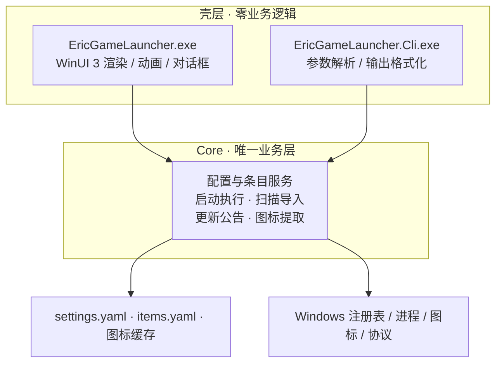

<!--
 readme编写规范：
  1. 所有readme都需要保留本说明且不可做任何翻译修改。主readme(中文版)是本说明的唯一源头(Source of Truth)，禁止将非中文版本中被修改的说明同步回主readme。非中文版的此说明需始终保持与主readme单向同步更新。
  2. 非中文版本的readme必须保留主readme(中文版)的所有视觉元素、HTML 标签、图标路径和排版格式，非中文版本的readme是中文版的完整对应精准同步翻译版，翻译不可笼统，不可修改原意，不可增减内容。
  3. 针对目标语言环境进行功能描述的本土化。
  4. 非中文版本的readme需要合理修改指向资源的路径，确保资源能够正确显示。
  5. 非中文版本的readme都需要保留并置顶本说明
  6. 非中文版本的readme都需要置顶以下元素，可以替换为相应的翻译版本但必须保留原意：
	    <div align="right">
	    <a href="../readme.md">For the latest updates, please refer to the Chinese README.</a>
	    </div>
  7. 任何关于项目内容的更新，必须首先在主readme(中文版)中完成。在主版确认无误后，再根据本规范同步至其他语言版本。
  8. 非中文版本的readme顶部的语言切换器仅保留指向主readme(中文版)的链接，不互相跳转。非中文版本的入口仅在主readme中统一显示。
-->

<div align="center">


<h1>Eric Game Launcher</h1>
<p><strong>让游戏启动回归纯粹与极速</strong></p>
<p>
<a href="https://github.com/EricZhang233/EricGameLauncher/releases/latest"></a>
<a href="https://github.com/EricZhang233/EricGameLauncher/releases/latest"></a>
<a href="https://github.com/EricZhang233/EricGameLauncher/stargazers"></a>
</p>
<p>
<a href="https://dotnet.microsoft.com/"></a>
<a href="https://github.com/microsoft/microsoft-ui-xaml"></a>
<a href="https://www.microsoft.com/windows"></a>
<a href="https://www.gnu.org/licenses/gpl-3.0.html"></a>
</p>
<p>
<a href="#highlights">亮点速览</a> • <a href="#quickstart">快速开始</a> • <a href="#features">功能详解</a> • <a href="#cli">命令行</a> • <a href="#settings">设置</a> • <a href="#architecture">技术架构</a> • <a href="#faq">常见问题</a> • <a href="#thanks">致谢</a> • <a href=".github/readme_res/readme_en.md">English</a>
</p>


</div>

---

<a name="highlights"></a>

## 亮点速览

*   🧩 **全链路执行**：主程序、管理器、代替启动、伴随执行四条链路逐项可配；EXE、快捷方式、URL 协议、网页、商店应用都能直接跑。
*   🖱️ **动态右键菜单**：菜单项随项目自动增减，识别到平台即显示「运行 Steam / 运行 Xbox」；每个项目最多 10 个自定义项，可独立配置标题、命令、参数与提权。
*   🗂️ **多平台一站收纳**：Steam、Epic Games、Xbox、Google Play Games、WeGame、独立 exe、网页与商店应用共处一库，顺序完全自定义。
*   🔍 **多路搜索**：拼音全拼、拼音首字母、中文、英文、路径与 URL 协议都能当关键词——`yxlm` 直达英雄联盟，`C:\Program Files` 按路径命中，`steam` 顺协议捞出全部。
*   📥 **扫描即入库**：自动识别 Steam、Epic Games、Xbox、Google Play Games 与 WeGame 已安装游戏，按新增 / 已存在 / 已失效分组，一键导入或批量清理。
*   💻 **CLI & Skill**：命令行与桌面端共用游戏库、设置和核心服务，内置帮助与接入指南，方便脚本与 AI Agent 管理和启动游戏。
*   🚀 **快速启动**：后台宿主预读配置、预热图标与界面，再次打开几乎瞬间出现；默认关闭，可通过“更多 → 退出”结束本次运行。
*   🗑️ **三段式删除**：主界面删除只进回收站，回收站删除才开始 72 小时倒计时，到期后下次启动自动清理——手滑也救得回来。
*   🎒 **完全便携**：配置与图标缓存可随程序走，塞进 U 盘即可随身携带；系统模式与便携模式之间一键迁移。

<a name="quickstart"></a>

## 快速开始

*   需要 Windows 11 24H2 或更高版本，支持 x64 和 ARM64 电脑。
*   运行前请安装 x64 版本的 [.NET 10 桌面运行时](https://dotnet.microsoft.com/en-us/download/dotnet/10.0) 和 [Windows App Runtime 1.8](https://learn.microsoft.com/windows/apps/windows-app-sdk/downloads)。

### 三步上手

1. **下载**：从 [Releases](https://github.com/EricZhang233/EricGameLauncher/releases) 取最新压缩包，解压到任意目录（路径含中文或空格都可以）。
2. **运行**：双击 `EricGameLauncher.exe`，首次启动自动完成初始化；需要桌面与开始菜单快捷方式就运行 `.install.cmd`。
3. **入库**：点右上角 **更多 → 扫描** 自动识别本机游戏并一键导入，或用 **更多 → 添加** 手动指定 exe、快捷方式、网页、商店应用。

---

<a name="features"></a>

## 功能详解

<div align="center">
  
</div>

### 一屏收纳你的全部游戏

*   **不分平台**：Steam、Epic Games、Xbox、Google Play Games、WeGame、独立 exe、网页链接、商店应用共用一个网格，顺序完全由你决定。
*   **图标可大可小**：从紧凑列表到沉浸大图连续可调，滑块即时生效，下次启动依旧保留。
*   **多路匹配**：`yxlm`（首字母）、`yingxionglianmeng`（全拼）、`部落`（中文）、`pcl`（路径）都能命中。
*   **手动排序**：直接在网格内拖动卡片，松开后保存顺序；拖动期间暂停名称悬停提示。
*   **悬停补全信息**：指针停留片刻即显示完整标题，长名字不必再猜。
*   **启动方式可选**：单击或双击启动，在设置里随时切换。

### 全链路执行：不止是快捷方式

配置一个游戏，等于配置一条完整的启动链路：

| 能力 | 说明 |
| :--- | :--- |
| **主程序** | 原生 `EXE`、`LNK` 快捷方式、`steam://` / `epic://` / `starward://` 等 URL 协议、网页链接、`shell:AppsFolder\` 商店应用，都可以作为启动目标。 |
| **以管理员身份运行** | 各执行目标可分别配置管理员权限，按对应程序的需求选择。 |
| **管理器** | 指定平台管理器路径，或使用已识别的平台入口，从右键菜单单独打开。 |
| **代替主程序启动** | 用自定义命令（例如 `starward://`）完全接管原始 EXE 的启动逻辑。 |
| **启动时同时执行** | 翻译器、计时器、性能监控、按键映射随游戏一起启动，一键双开。 |
| **自定义右键菜单** | 单个项目最多 10 个自定义项，标题、命令、参数、是否提权各自独立；删掉中间项后自动补位。 |
| **参数与环境变量** | 所有执行目标都支持完整参数；`%AppData%`、`%LocalAppData%` 自动展开；属性面板提供独立的路径和参数编辑位置。 |

### 属性面板：每个细节都能改

*   **名称与图标**：随时改名，也可以上传自己的图片当封面。
*   **四类执行目标分栏**：主程序、管理器、代替启动、伴随执行各自独立成行，都带文件选择与参数拆分。
*   **自定义菜单可视化编辑**：标题、命令、提权开关一列排开，最多 10 组。
*   **保存即刻生效**：确认后立即写回本地配置，界面同步刷新；可将客户端标记为游戏平台，并设置是否固定到任务栏快捷列表。

<div align="center">
  
  
  <br/>
  <sub>左：属性面板（可配置项一览）　右：扫描结果（新增 / 已存在 / 已失效）</sub>
</div>

### 一键扫描多个平台

| 平台 | 自动扫描支持 |
| :--- | :--- |
| Steam | 读取本机游戏库与安装清单，支持多个库目录。 |
| Epic Games | 读取本机安装记录，生成对应的平台启动入口。 |
| Xbox / Microsoft Store | 从已安装的商店应用中识别游戏。 |
| Google Play Games | 读取当前用户的本机游戏库，过滤 Google 和 Android 内部组件；有匹配的开始菜单快捷方式时沿用其启动地址。 |
| WeGame | 根据当前用户安装记录发现游戏与启动入口；主列表已有同一游戏目录内的其他启动程序时，按已存在项目处理。 |

其他平台的游戏也可以通过 **更多 → 添加** 手动收录，使用程序、快捷方式或对应客户端已注册的协议地址启动。

*   **自动发现**：原生识别 Steam、Epic Games、Xbox（Microsoft Store / UWP）、Google Play Games 与 WeGame已安装游戏，提取路径并抓取图标。
*   **结果分组**：扫描结果按 **新增 / 已存在 / 已失效** 三组列出，已入库的项目不会重复导入。
*   **一键导入**：全选或逐项勾选后入库。
*   **失效清理**：已卸载或路径失效的项目集中呈现，支持批量删除。

### 任务栏直达平台与常用游戏

右键任务栏上的启动器图标，即可启动固定平台或常用游戏。固定平台沿用主界面顺序，常用项目优先显示手动固定项，其余按成功启动次数排列。在属性面板调整固定状态并保存后，列表会在后台刷新。

### 三段式删除：手滑也能救回来

| 阶段 | 行为 |
| :--- | :--- |
| 第一段 | 主界面删除 → 只移入回收站，游戏还在，随时可以还原。 |
| 第二段 | 回收站中删除 → 进入 72 小时倒计时，界面显示剩余时间。 |
| 第三段 | 倒计时结束 → 下次启动时自动彻底清理。 |

除了逐项还原和删除，回收站也支持一键清空，清空后同样保留 72 小时。还原时若主列表已存在相同路径或项目 ID，会提示冲突。

### 更新与公告

*   **静默检查更新**：启动时自动查询 GitHub Releases，有新版本时通过版本号与更新图标提示；遇到强制更新会显示更新窗口。
*   **双通道**：**正式版** 只收正式发布，**开发版** 第一时间尝鲜。
*   **一键下载安装**：发现新版本后下载安装，由更新器替换程序；当前版本有可用发行包时，也能执行修复重装。手动检查会立即显示进度。
*   **历史更新记录**：左侧版本列表、右侧完整说明，可跳转到任意版本，内容取自 GitHub 发布记录。
*   **公告中心**：启动时拉取云端公告，正文支持 Markdown、中英双语，已读状态本地持久化，未读带红点提示。
*   **更新保护**：下载完成后先核验 GitHub Asset 的 SHA256，通过才退出并安装；校验失败可重试或关闭更新界面。安装失败会尝试回滚，回滚失败保留备份供恢复。
*   **配置保护**：写入采用原子替换并保留 `.bak`；损坏配置不会被空列表自动覆盖。GUI 与 CLI 的条目修改通过跨进程事务保存。
*   **删除边界**：主列表删除移入回收站，回收站再次删除或清空后保留 72 小时；游戏文件保留在原处。

<a name="settings"></a>

### 设置一览

*   **常规**：快速启动、启动方式（单击 / 双击）、启动后自动退出；动画遵循 Windows 设置。
*   **更新**：更新通道（正式版 / 开发版）、GitHub 令牌（提高 API 限额；令牌以 DPAPI 加密后存于本地）。
*   **数据**：数据位置（便携 / 系统）一键迁移，并可快速打开配置目录与缓存目录。
*   **标题栏**：图标大小、回收站、快捷方式创建与卸载、隐私与权限说明、检查更新。

将指针移到设置项的图标或名称上可查看说明，点击可展开帮助。

### 快速启动：提前预热，随时打开

*   **后台宿主**：登录后常驻宿主预读配置与条目、校验并重建图标、完整预热一次界面，再把界面释放掉，屏幕上不留任何窗口。
*   **为下次打开做好准备**：宿主保留已预热的资源，再次打开时唤起界面；具体耗时取决于电脑和游戏库。
*   **遵循系统动画**：启动画面遵循 Windows 动画设置，系统关闭动画时直接显示最终状态。
*   **要彻底退出**：**更多 → 退出** 立刻结束界面与后台宿主，且不改动快速启动设置；Windows 11 24H2 及以上也可以在任务栏右键选择「结束任务」。
*   **不想要后台**：关掉开关，自启项随即移除。

---

<a name="cli"></a>

## 命令行：与脚本共用同一个游戏库

`EricGameLauncher.Cli.exe` 与桌面端共用核心服务和数据，方便从终端启动游戏，并通过脚本管理游戏库、设置和回收站。

随程序内置两份文档，不必再去找别的说明：

```powershell
.\EricGameLauncher.Cli.exe -help  ----覆盖当前版本的全部命令与参数
.\EricGameLauncher.Cli.exe skill  ----输出面向脚本和 AI Agent 的完整接入指南
```
---

<a name="architecture"></a>

## 技术架构

**Eric Game Launcher** 的桌面界面与控制台共用 Core 服务，统一处理配置、游戏库、启动、扫描与更新。



*   **前沿技术栈**：**Windows App SDK 1.8** + **WinUI 3** + **.NET 10**，使用 Mica / 亚克力材质与自适应网格。
*   **单一 Core 原则**：桌面端与命令行共用业务层，功能天然对齐，日志统一记录。
*   **人机皆可读的配置**：YAML（`YamlDotNet`）存储，`settings.yaml` 与 `items.yaml` 分离，高频改动不必重写全部数据。
*   **原生性能**：P/Invoke 调用系统接口完成图标提取与缓存，窗口材质与标题栏交给系统合成。
*   **拼音索引**：`TinyPinyin` 在内存中为标题建立全拼与首字母索引，搜索时直接匹配已有索引。
*   **安全存储**：GitHub 令牌使用 DPAPI 加密后落盘，不写入明文。
*   **Unpackaged 发布**：无需 MSIX 打包与证书导入，解压即用的绿色版本；更新由内置影子组件在临时目录完成替换。
*   **单实例与快速唤醒**：Win32 单实例与消息唤醒机制保证重复启动不会开出多个窗口，而是直接唤起已有实例。

---

<a name="faq"></a>

## 常见问题

<details>
<summary><b>为什么登录后任务管理器里会有一个 EricGameLauncher 进程？</b></summary>

这是「快速启动」的后台宿主，用于预读配置与预热界面，让下次打开几乎瞬间完成。快速启动默认关闭。启动器还会向 GitHub 检查更新和获取公告。

不想要的话，在 **设置 → 快速启动** 关闭即可，自启项会被立即移除；也可以随时通过 **更多 → 退出** 结束它。
</details>

<details>
<summary><b>怎么彻底退出，而不是留在后台？</b></summary>

打开 **更多 → 退出**，界面与后台宿主会一起结束，且不会改动快速启动设置。在 Windows 11 24H2 及以上，也可以直接在任务栏右键选择「结束任务」。
</details>

<details>
<summary><b>需要安装吗？会写注册表吗？</b></summary>

不需要安装，解压即用。只有在以下情况才会写入系统：开启快速启动（注册登录自启）、创建快捷方式（写入开始菜单 / 桌面）。游戏扫描会读取本地磁盘和安装记录；识别商店应用类别时，可能向微软查询包系列名称。更新与公告访问 GitHub。
</details>

<details>
<summary><b>我的数据存在哪里？</b></summary>

默认为系统模式，存放于 `%ProgramData%\eric\EricGameLauncher`，其中 settings.yaml 保存设置、items.yaml 保存游戏库和回收站、ico 保存图标；也可以切换到便携模式，把数据放进程序目录下的 `Data` 文件夹，随程序一起搬走。切换模式会迁移配置和图标。临时缓存与启动次数仍保存在 `%TEMP%\eric\ericgamelauncher`；备份游戏库时应保留整个数据目录。
</details>

<details>
<summary><b>支持 Windows 10 吗？</b></summary>

不支持。本项目基于 Windows App SDK 1.8 与 WinUI 3，需要 **Windows 11 24H2（Build 26100）** 或更高版本。
</details>

<details>
<summary><b>ARM64 电脑应该下载哪个版本？</b></summary>

下载同一份 x64 发行包即可，程序通过 Windows 11 的 x64 模拟运行。运行依赖也请选择 x64 版本，包括 .NET 10 桌面运行时与 Windows App Runtime 1.8。
</details>

<details>
<summary><b>扫描没找到某款游戏，能手动添加吗？</b></summary>

可以，通过 **更多 → 添加** 选择游戏程序或快捷方式，也可填写平台协议、网页或商店应用入口。扫描依赖各平台的本机安装记录，扫描未发现游戏时可先确认对应客户端能正常识别它；不要仅凭扫描结果判断游戏已经卸载。使用平台协议启动时，本机需要安装对应客户端。
</details>

<details>
<summary><b>取消固定后，为什么任务栏里还能看到这款游戏？</b></summary>

普通游戏取消固定后，仍可能按启动次数出现在常用项目中。游戏平台取消固定后才会从平台组隐藏。可在项目属性中检查“这是个游戏平台”和固定状态，保存后等待任务栏列表刷新。清理临时缓存会重置对应的启动次数。
</details>

---

## 贡献与支持

我们欢迎任何形式的贡献——无论是提交 Bug、改进文档，还是提交代码（PR）。

*   发现异常或有功能建议？欢迎前往 [Issues](https://github.com/EricZhang233/EricGameLauncher/issues) 反馈，附上复现步骤会更快被处理。
*   想参与开发？在 Windows 上使用仓库指定的 .NET 10 SDK 构建 `EricGameLauncher.csproj`，完整本地测试入口为 `dotnet test`，发行包由 GitHub 工作流构建。详见[仓库规范](agent.md)、[测试说明](Test/README.md)和[构建说明](.github/BUILDING.md)。

如果您觉得这个项目对您有帮助，请给它由衷的一颗 ⭐️ **Star**！

<a name="thanks"></a>

## 特别致谢
*   [**Starward**](https://github.com/Scighost/Starward): 一个功能强大的米哈游游戏启动器。我们最初的对此项目的构想只是一个本地游戏的集合启动器，没计划支持分发平台。一开始之所以支持url-scheme协议，就是因为需要支持他的协议来支持记录米家游戏游戏时长。后来想了想既然都支持了url-scheme了，那就支持一下诸如 Steam/Epic Games 等平台的协议吧，结果就有了现在这个支持分发平台启动器的功能。Starward在米哈游游戏启动器领域的创新和贡献是不可磨灭的，我们希望通过支持其协议来向其致敬，并为玩家提供更多选择。借由这个契机，我们的启动器应该能支持绝大部分的启动器url-scheme协议和带参执行。

## 友情链接
*   [**TaskbarLyrics**](https://github.com/ANYNC/TaskbarLyrics): 一个相当好用的任务栏歌词软件，参与维护的另一项目。

---
<div align="center">
  Made with ❤️ by EricZhang233
</div>
