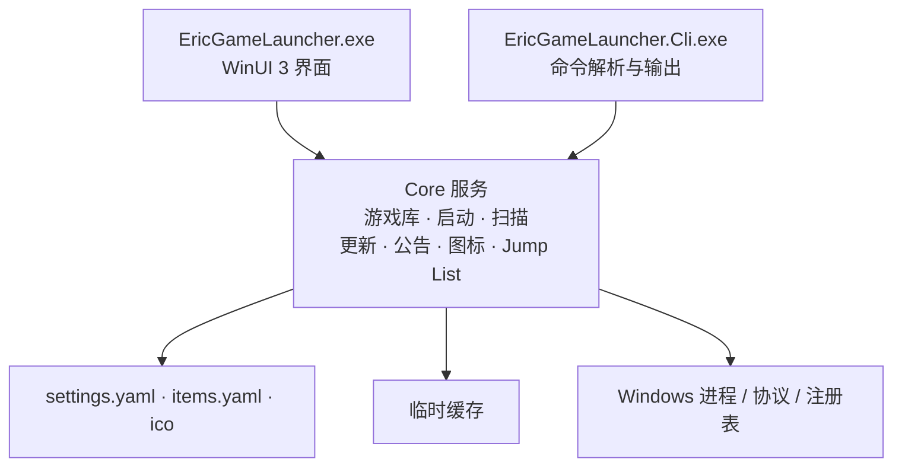

<!--
 readme编写规范：
  1. 所有readme都需要保留本说明且不可做任何翻译修改。主readme(中文版)是本说明的唯一源头(Source of Truth)，禁止将非中文版本中被修改的说明同步回主readme。非中文版的此说明需始终保持与主readme单向同步更新。
  2. 非中文版本的readme必须保留主readme(中文版)的所有视觉元素、HTML 标签、图标路径和排版格式，非中文版本的readme是中文版的完整对应精准同步翻译版，翻译不可笼统，不可修改原意，不可增减内容。
  3. 针对目标语言环境进行功能描述的本土化。
  4. 非中文版本的readme需要合理修改指向资源的路径，确保资源能够正确显示。
  5. 非中文版本的readme都需要保留并置顶本说明
  6. 非中文版本的readme都需要置顶以下元素，可以替换为相应的翻译版本但必须保留原意：
	    <div align="right">
	    <a href="../readme.md">For the latest updates, please refer to the Chinese README.</a>
	    </div>
  7. 任何关于项目内容的更新，必须首先在主readme(中文版)中完成。在主版确认无误后，再根据本规范同步至其他语言版本。
  8. 非中文版本的readme顶部的语言切换器仅保留指向主readme(中文版)的链接，不互相跳转。非中文版本的入口仅在主readme中统一显示。
-->

<div align="center">

# Eric Game Launcher

**让游戏启动回归纯粹与极速**

  <a href="https://github.com/EricZhang233/EricGameLauncher/releases/latest"></a>
  <a href="https://github.com/EricZhang233/EricGameLauncher/releases/latest"></a>
  <a href="https://github.com/EricZhang233/EricGameLauncher/stargazers"></a>

  [](https://dotnet.microsoft.com/)
  [](https://github.com/microsoft/microsoft-ui-xaml)
  [](https://www.microsoft.com/windows)
  [](https://www.gnu.org/licenses/gpl-3.0.html)

<a href="#highlights">亮点速览</a> • <a href="#quickstart">快速开始</a> • <a href="#features">功能详解</a> • <a href="#cli">命令行</a> • <a href="#settings">设置</a> • <a href="#architecture">技术架构</a> • <a href="#faq">常见问题</a> • <a href="#thanks">致谢</a> • <a href=".github/readme_res/readme_en.md">English</a>

<div align="center">
  
</div>
</div>

---

<a name="highlights"></a>

## 亮点速览

Eric Game Launcher 将本机游戏、平台客户端和其他启动入口集中到一个游戏库，提供桌面界面、任务栏入口与命令行操作。

* **统一游戏库**：收纳 EXE、快捷方式、URL 协议、网页与商店应用，支持拖动排序、图标大小调整和拼音搜索。
* **五个平台扫描**：发现 Steam、Epic Games、Xbox、Google Play Games 与 WeGame 已安装游戏，区分新增、已存在和已失效项目。
* **可配置的启动方式**：主程序、管理器、代替启动、伴随执行分别配置命令和权限，每个项目还可添加最多 10 个右键菜单项。
* **任务栏直达**：Jump List 显示固定平台和常用项目；通过属性中的 Pin 或 CLI 管理固定状态。
* **可选快速启动**：默认关闭；开启后注册登录自启，以后台宿主预读数据、预热界面。
* **数据与自动化**：系统 / 便携模式可迁移，回收站提供恢复机会；CLI 与桌面端共用核心服务和配置。

<a name="quickstart"></a>

## 快速开始

### 环境要求

| 项目 | 要求 |
| :--- | :--- |
| 操作系统 | Windows 11 24H2（Build 26100）或更高版本 |
| 程序架构 | x64，未提供 ARM64 原生版本 |
| 运行依赖 | .NET 10 Desktop Runtime 与 Windows App SDK 1.8 |
| 部署方式 | 下载发布 ZIP 并完整解压，保留目录中的组件；程序使用外部运行时 |

### 三步上手

1. **下载**：从 [Releases](https://github.com/EricZhang233/EricGameLauncher/releases) 下载软件包，完整解压到可写目录。
2. **运行**：打开 `EricGameLauncher.exe`。缺少依赖时先按系统提示准备运行时；需要桌面和开始菜单快捷方式，可运行包内 `.install.cmd`。
3. **入库**：在 **更多 → 扫描** 中选择并导入本机游戏，或通过 **更多 → 添加** 手动创建启动项目。

---

<a name="features"></a>

## 功能详解

<div align="center">
  
</div>

### 一屏收纳你的全部游戏

* **统一入口**：不同平台的游戏、独立程序、网页和商店应用共用一个网格。
* **排序与显示**：直接拖动项目调整顺序；图标大小、窗口位置与尺寸可保存。
* **搜索**：按标题、路径、拼音全拼或首字母匹配，例如用 `yxlm` 搜索“英雄联盟”。
* **操作习惯**：支持单击或双击启动，名称过长时可通过悬停查看完整标题。

### 全链路执行：不止是快捷方式

| 能力 | 说明 |
| :--- | :--- |
| **主程序** | 支持 EXE、LNK、已注册的 URL 协议、HTTP(S) 网页和 `shell:AppsFolder\` 应用入口。协议能否启动取决于本机是否安装了对应客户端。 |
| **管理器** | 为项目指定管理器，或使用识别到的平台入口；可从右键菜单单独运行。 |
| **代替启动** | 配置并启用另一条命令代替主程序启动，例如调用其他启动器的协议。 |
| **伴随执行** | 开启后，在主启动命令成功提交后执行附加命令，例如启动翻译器或监控工具。 |
| **权限与参数** | 各执行目标可分别配置管理员权限和参数，支持展开环境变量。带参数的命令可在属性面板中拆分编辑。 |
| **自定义右键菜单** | 每个项目最多 10 项，分别设置标题、命令、参数与管理员权限。 |

启动成功表示启动命令已交给系统执行，不代表游戏已经完成加载。

### 快速启动：后台预热与窗口唤醒

* **默认关闭**：开启后写入当前用户的登录自启项，由后台宿主预读配置、检查图标并完成一次界面预热，随后释放界面。
* **关闭窗口**：开启快速启动时，窗口关闭后宿主继续驻留；再次运行程序可重新打开界面。
* **彻底退出**：使用 **更多 → 退出** 或 CLI `exit` 结束界面与宿主，保留快速启动设置。
* **关闭快速启动**：移除登录自启注册；开关不影响系统动画设置。
* **动画**：应用动画遵循 Windows 的动画开关，系统关闭动画时直接切换视觉状态。

### 属性面板：每个细节都能改

* **基础信息**：修改名称、图标、平台标签与各类启动命令，保存后写入配置。
* **游戏平台标记**：通过“这是个游戏平台”区分平台客户端与普通游戏；旧配置只在缺少标记时自动推断，显式选择会保留。
* **Pin 固定**：管理任务栏列表中的固定状态；平台项目默认固定，普通项目也可固定。
* **右键菜单**：编辑最多 10 个自定义操作，按需配置参数与权限。

<div align="center">
  
  
  <br/>
  <sub>左：属性面板　右：扫描结果；图片供界面参考，具体选项以当前版本为准。</sub>
</div>

### 扫描五个平台的已安装游戏

| 平台 | 发现范围与边界 |
| :--- | :--- |
| Steam | 读取本机 Steam 游戏库与安装信息。 |
| Epic Games | 读取本机 Epic Games 安装记录。 |
| Xbox | 发现本机受支持的商店 / Xbox 游戏入口。 |
| Google Play Games | 读取并在本地解密当前用户的应用库，排除 `com.google`、`com.android` 前缀的包。 |
| WeGame | 读取当前用户安装清单，只检查清单中的游戏库及 Rail 游戏标识，并要求有效的 WeGame 启动入口；名称来自游戏目录。 |

扫描结果按 **新增 / 已存在 / 已失效** 分组，可勾选导入或清理。导入会保留平台标签与可用管理器，WeGame 同一游戏目录中的不同可执行文件按同一游戏去重。

Google Play Games 与 WeGame 使用客户端内部数据格式；不兼容、损坏或解密失败会报告扫描错误，不能据此认定现有游戏已经卸载。WeGame 扫描不遍历全部磁盘，也不枚举系统已安装程序。

### 三段式删除：为误操作保留恢复机会

| 阶段 | 行为 |
| :--- | :--- |
| 主界面删除 | 项目移入回收站，可以恢复；不卸载游戏或删除游戏文件。 |
| 回收站删除 / 清空 | 标记待清理，开始 72 小时保留期，期间仍可恢复。 |
| 保留期结束 | 后续启动或执行清理时移除到期记录。 |

恢复时若主列表已存在相同路径或项目 ID，会报告冲突。CLI 的 `remove --permanent` 与 `recycle --purge` 是立即删除记录的显式操作，不经过上述保留期。

### 更新与公告

* **版本检查**：从 GitHub Releases 获取版本与更新说明；正式版通道使用正式发布，开发版通道允许获取预发布。
* **安装与修复**：支持下载安装更新和强制重装。下载包必须通过 GitHub 附件 SHA256 校验，缺少有效摘要或校验失败时不会进入安装。
* **失败恢复**：更新安装失败时尝试回滚，无法回滚时保留备份供恢复。
* **历史与公告**：可查看历史发布说明及云端公告，公告支持 Markdown 和中英文内容，已读状态保存在本地。
* **配置保护**：配置写入采用原子替换并保留 `.bak`；损坏配置会阻止写入，避免被空数据覆盖。GUI 与 CLI 的条目修改通过跨进程事务保存。

<a name="settings"></a>

### 设置一览

| 入口 | 可调整内容 |
| :--- | :--- |
| 常规 | 快速启动、单击 / 双击启动、启动后自动退出 |
| 更新 | 正式版 / 开发版通道、GitHub 令牌 |
| 数据 | 系统 / 便携模式迁移，打开配置目录与缓存目录 |
| 其他界面入口 | 图标大小、回收站、快捷方式创建与卸载、隐私与权限说明、更新检查 |

部分设置的图标与标签可悬停查看说明，点击展开帮助。GitHub 令牌以 Windows DPAPI 加密后保存，迁移到另一台电脑或其他 Windows 用户环境时可能需要重新填写。

---

<a name="cli"></a>

## 命令行：与桌面端共用游戏库

`EricGameLauncher.Cli.exe` 位于主程序旁，提供游戏库管理、启动、搜索、排序、扫描、回收站、设置、更新、公告、快捷方式与存储模式操作。

在程序目录打开 PowerShell：

```powershell
.\EricGameLauncher.Cli.exe -help
.\EricGameLauncher.Cli.exe skill
.\EricGameLauncher.Cli.exe list --json
.\EricGameLauncher.Cli.exe scan --all --classify --json
```

`-help` 列出当前版本命令与参数；`skill` 输出构建时嵌入的完整接入指南。发布目录中的 `SKILL.md` 提供接入入口。

脚本应优先使用稳定项目 ID 与 `--json`：JSON 模式的标准输出只包含 JSON，诊断与进度写入标准错误；退出码 `0` 表示成功，`1` 表示失败。多个回收站记录共享项目 ID 时，应使用 `recycleId` 精确恢复。

---

<a name="architecture"></a>

## 技术架构

桌面端与 CLI 共用 Core 服务，界面负责渲染与交互，控制台负责命令解析与输出。



* **技术栈**：.NET 10、Windows App SDK 1.8、WinUI 3；仅发布 win-x64，采用未打包应用部署。
* **配置**：使用 YamlDotNet，设置与条目分别保存为 `settings.yaml` 和 `items.yaml`，图标保存在数据目录的 `ico` 中。
* **搜索**：使用 TinyPinyin 建立标题拼音索引，并匹配标题和路径。
* **任务栏**：Jump List 分为游戏平台与常用项目两段。固定平台按主面板顺序显示，普通固定项目排在常用段前，其余常用项目自动排列。取消 Pin 的平台隐藏，实际可见数量受屏幕空间限制。
* **实例与更新**：通过单实例唤醒机制处理重复打开；更新组件嵌入主程序，运行时释放到临时目录。

---

<a name="faq"></a>

## 常见问题

<details>
<summary><b>为什么关闭窗口后仍有后台进程？</b></summary>

开启快速启动后，后台宿主会在窗口关闭后继续驻留。可在设置中关闭快速启动，或使用 **更多 → 退出** / CLI `exit` 结束本次宿主。
</details>

<details>
<summary><b>任务栏项目如何固定或隐藏？</b></summary>

在属性中修改 Pin 并保存，或通过 CLI 修改。平台取消 Pin 后隐藏；普通项目取消 Pin 后仍可能出现在常用段。列表由应用管理，请通过应用内的 Pin 调整；遗留的系统固定项可手动取消。
</details>

<details>
<summary><b>需要安装吗？会改动哪些系统位置？</b></summary>

程序通过 ZIP 分发，需要外部运行时。创建快捷方式会写入桌面与开始菜单；开启快速启动会写入当前用户登录自启项。扫描读取本地安装记录，更新与公告访问 GitHub。快捷方式“卸载”移除快捷方式并关闭快速启动，不删除游戏库或游戏文件。
</details>

<details>
<summary><b>我的数据存在哪里？便携模式会搬走所有缓存吗？</b></summary>

默认配置与图标位于 `%ProgramData%\eric\EricGameLauncher`；便携模式使用程序目录的 `Data`。可在设置中迁移。临时缓存仍位于 `%TEMP%\eric\ericgamelauncher`，不随便携目录一起搬走。备份游戏库时应保留整个数据目录。
</details>

<details>
<summary><b>支持 Windows 10 或 ARM64 原生版本吗？</b></summary>

当前项目目标为 Windows 11 24H2（Build 26100）及以上的 x64 环境，未提供 Windows 10 支持或 ARM64 原生发布包。
</details>

---

## 贡献与支持

欢迎通过 [Issues](https://github.com/EricZhang233/EricGameLauncher/issues) 提交问题或建议；反馈时请提供版本、操作步骤、预期与实际结果，以及必要的脱敏日志。

参与开发前请阅读 [仓库规范](agent.md)。使用 .NET 10 SDK，直接构建 `EricGameLauncher.csproj`；本地日常使用 Debug，发布包由 GitHub 工作流构建。测试入口是 `dotnet test`，依赖与分组见 [测试说明](Test/README.md)，发布流程见 [构建说明](.github/BUILDING.md)。

如果这个项目对你有帮助，欢迎 Star 支持。

<a name="thanks"></a>

## 特别致谢

* [**Starward**](https://github.com/Scighost/Starward)：最初支持 URL 协议是为了通过 Starward 启动米哈游游戏并记录时长，这也促成了对其他平台协议与带参执行的支持。
* [**胡桃工具箱 (Snap Hutao)**](https://github.com/DGP-Studio/Snap.Hutao)：感谢原项目团队的贡献与开源精神。[**R.I.P**](https://hut.ao/)
* [**胡桃工具箱重制版 (Snap Hutao Remastered)**](https://github.com/SnapHutaoRemasteringProject/Snap.Hutao.Remastered)：感谢对胡桃工具箱功能与社区的延续，也是作者目前使用的原神工具箱。

## 友情链接

* [**TaskbarLyrics**](https://github.com/ANYNC/TaskbarLyrics)：任务栏歌词软件，也是作者参与维护的项目。

---

<div align="center">
  Made with ❤️ by EricZhang233
</div>
